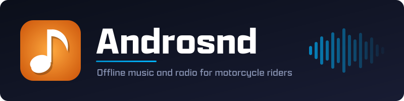

  

An offline music and internet-radio player for motorcycle riders. Built for [DMD](https://www.dmdnavigation.com) navigation units and the DMD Remote2 controller: landscape-only, no accounts, no streaming services, driven entirely by the remote.

This is opinionated software, built for one hardware setup. If it matches yours, great. If not, it probably won't make you happy.

---

## Features

- **DMD Remote2 control** — full navigation without touching the screen.
- **Two playback modes** — local music files and internet radio, one button to switch.
- **Folder-based library** — your directory layout is the library; no ID3 cleanup needed.
- **Internet radio** — bundled RPR1 and SomaFM stations plus your own stream URLs.
- **Radio timeshift** — buffers up to an hour ahead, so pause/resume and dropouts don't cut the audio.
- **Relative volume** — play music at 30% while navigation prompts stay at 100%.
- **Shuffle** — random playback for files and radio alike.
- **Now Playing overlay** — floating popup over other apps, draggable and pinch-resizable.
- **100% offline for playback** — the network is only touched for radio and update checks.

---

## Getting started

1. Install the APK and launch Androsnd.
2. Grant the permissions it requests (see [Permissions](#permissions)).
3. Open **Settings** and tap **Load Music Folder**.
4. Pick the root of your music collection — it is scanned recursively.
5. Press Play. To listen to radio instead, press the **Mode** button.

The library is rescanned each time you load a folder. There is no background sync.

---

## Layout

The screen is split into two panels with a button bar along the bottom.

- **Left panel** — album art, title, artist, album, time remaining, and a vertical volume slider.
- **Right panel** — folder/song browser (or station list in radio mode).
- **Bottom bar**, left to right — Mode, Previous, Play/Pause, Next, Shuffle, Folders, Settings.

---

## Remote control (DMD Remote2)

Androsnd is meant to be driven entirely by the remote; only Settings needs the touchscreen.

| Button | Action |
|---|---|
| Up / Down | Move through the song list |
| Left / Right | Move between bottom-bar buttons |
| Button 1 | Activate the focused button — or play the focused song if it isn't the current one |
| Button 1 (hold on Play) | Stop playback |
| Button 2 | Close folder browser → close settings → background the app |
| Lever Up / Down | Volume ±5% (repeats when held) |

The focus ring appears on the first remote key press and stays visible while navigating.

---

## Internet radio

Press **Mode** to switch between local files and radio; playback carries across the switch. Androsnd ships with RPR1 and SomaFM stations and shows live track info from the stream. Add your own station in **Settings** with a name and stream URL. The timeshift buffer fills up to an hour ahead, so a pause or a brief network drop resumes from the buffer rather than silence.

---

## Now Playing overlay

A floating "Now Playing" popup can appear over other apps when the track changes. Drag it to reposition (remembered across songs) or pinch to resize live. It needs the "Display over other apps" permission; revoke it and the overlay silently stops appearing. All options live under Settings.

---

## Settings

| Setting | Purpose |
|---|---|
| Load Music Folder | Pick and scan the music root |
| Check for Updates | Fetch and install the latest release |
| Show Now Playing Overlay | Enable/disable the floating popup |
| Now-Playing Popup Opacity | Overlay transparency |
| Now-Playing Popup Size | Overlay scale (also pinch-to-resize) |
| Show Demo Popup | Preview the overlay |
| Add web stream | Add a radio station by name + URL |

---

## Supported formats

mp3, ogg, flac, aac, m4a, opus. Cover art is read from `cover`, `folder`, `front`, `album`, or `artwork` (`.jpg`/`.jpeg`/`.png`) in the song's folder.

---

## Permissions

| Permission | Why |
|---|---|
| Read audio files | Access your music library |
| Internet | Radio streaming and the update checker — never used for local playback |
| Display over other apps | Now Playing overlay |
| Foreground service | Keep playing when backgrounded or the screen is off |
| Notifications | Playback controls in the notification shade |
| Wake lock | Prevent the CPU sleeping mid-track |
| Install packages | In-app update installation |
| Ignore battery optimizations | Stop Android killing the service on long rides |
